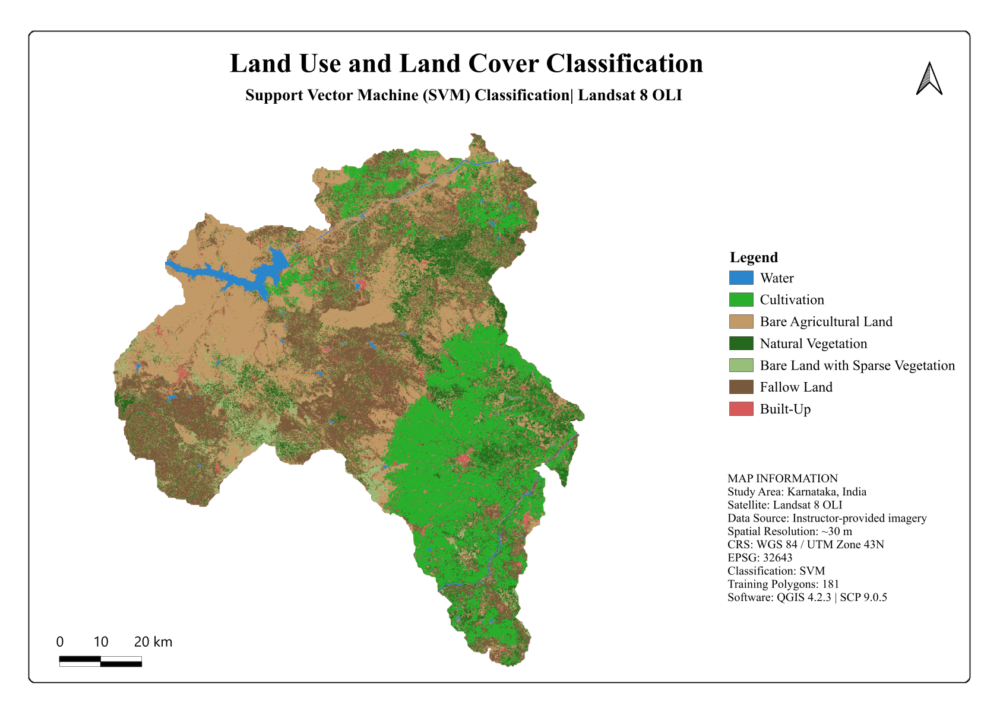

# Land Use and Land Cover Classification Using SVM — Karnataka, India (2023)

## Project Overview

This project demonstrates supervised Land Use and Land Cover (LULC) classification using Landsat 8 multispectral imagery, QGIS and the Support Vector Machine (SVM) algorithm.

The objective was to distinguish seven land-cover classes, quantify their mapped areas and assess classification agreement through visual reference interpretation.

## Project Objectives

- Process multispectral satellite imagery.
- Prepare representative training samples.
- Perform supervised machine learning classification.
- Produce a thematic LULC map.
- Evaluate classification accuracy.
- Quantify land-cover area and percentage distribution.

## Data and Tools

| Parameter | Description |
|---|---|
| Study area | Karnataka, India |
| Satellite | Landsat 8 |
| Imagery year | 2023 |
| Input imagery | Six-band clipped composite |
| Spatial resolution | Approximately 30 m |
| Coordinate reference system | WGS 84 / UTM Zone 43N (EPSG:32643) |
| Classification algorithm | Support Vector Machine (SVM) |
| Software | QGIS 4.2.3 |
| Plugin | SCP 9.0.5 |
| Training polygons | 181 |
| Validation points | 210 |

Additional tools: Python, PyQGIS, GDAL, NumPy and pandas.

Google Satellite imagery and the Landsat composite were used for visual reference interpretation.

---

## Methodological Workflow

### 1. Satellite Imagery Preparation

A six-band Landsat 8 multispectral composite was prepared and clipped to the study area for supervised classification.

*Figure 1. Clipped Landsat 8 multispectral composite used as classification input.*

### 2. Training Sample Preparation

A total of 181 training polygons were used to represent seven land-cover classes.

Training samples were delineated through visual interpretation of satellite imagery and assigned appropriate class identifiers.

*Figure 2. Detailed view of training polygons used for supervised classification.*

### 3. Support Vector Machine Classification

The Support Vector Machine (SVM) algorithm was applied to the multispectral composite to classify the study area into seven land-cover categories.

*Figure 3. Seven-class SVM classification output in QGIS.*

### 4. Validation Sampling

A stratified validation dataset containing 210 points was prepared, with 30 points per mapped class.

Reference labels were assigned through visual interpretation of Google Satellite imagery and the Landsat composite with the classified raster hidden.

Three validation locations were replaced to satisfy the 30-metre training-separation criterion.

*Figure 4. Spatial distribution of the final 210 validation points over the classified raster.*

### 5. Accuracy Assessment and Area Analysis

Python-assisted GIS analysis was used to calculate:

- Confusion matrix
- Overall Accuracy
- Cohen's Kappa
- Producer's Accuracy
- User's Accuracy
- Area-weighted Overall Accuracy point estimate
- Land-cover area and percentage distribution

---

## Final LULC Map

[Download final LULC map (PDF)](LULC_Final_Map.pdf)

---

## Mapped Land-Cover Distribution

| Class | Area (ha) | Coverage (%) |
|---|---:|---:|
| Water | 14,269.34 | 1.83 |
| Cultivation | 158,105.09 | 20.31 |
| Bare Agricultural Land | 289,587.07 | 37.20 |
| Natural Vegetation | 126,870.81 | 16.30 |
| Bare Land with Sparse Vegetation | 22,939.58 | 2.95 |
| Fallow Land | 157,815.95 | 20.27 |
| Built-Up | 8,879.38 | 1.14 |
| **Total** | **778,467.22** | **100.00** |

Bare agricultural land was the dominant mapped class, followed by cultivation and fallow land.

Cultivation and fallow land occupied approximately equal proportions of the mapped study area.

Percentages are rounded independently.

---

## Classification Accuracy Assessment

| Metric | Observed Result |
|---|---:|
| Training polygons | 181 |
| Validation points | 210 |
| Validation points per mapped class | 30 |
| Correctly classified validation points | 210 |
| Incorrectly classified validation points | 0 |
| Sample Overall Accuracy | 100% |
| Sample Cohen's Kappa | 1.00 |
| Producer's Accuracy | 100% for each class |
| User's Accuracy | 100% for each class |
| Area-weighted Overall Accuracy point estimate | 100% |
| Points within 30 m of training polygons | 0 |
| Missing reference labels | 0 |

### Training-Validation Separation

A 30-metre exclusion buffer was applied around the 181 training polygons to check spatial separation between training and validation samples.

Three validation locations were replaced during the verification process.

The final dataset satisfied the 30-metre separation criterion, with no validation points located within the exclusion buffers.

### Area-Weighted Accuracy

Because the validation sample contained equal numbers of points per mapped class, despite differences in mapped class areas, an area-weighted Overall Accuracy point estimate was calculated using mapped class-area proportions.

The resulting point estimate remained 100%, as no disagreements were observed in the validation sample.

---

## Statistical Results and Documentation

| File | Description |
|---|---|
| [Class Area Statistics](LULC_Final_Class_Areas.csv) | Pixel counts, hectares and percentage coverage |
| [Confusion Matrix](LULC_Final_Confusion_Matrix.csv) | Seven-class validation matrix |
| [Class-wise Accuracy](LULC_Final_Class_Accuracy.csv) | Producer's and User's Accuracy |
| [Accuracy Summary](LULC_Final_Accuracy_Summary.csv) | Overall Accuracy and Cohen's Kappa |
| [Detailed Methodology](Methodology.md) | Technical workflow and validation procedures |

---

## Scientific Limitations

- The perfect observed classification agreement is unusually high and should not be interpreted as proof of an error-free map.
- Google Satellite imagery acquisition dates were not verified against the 2023 Landsat acquisition.
- Seasonal land-cover changes may affect the interpretation of cultivation, fallow land and bare agricultural land.
- The Landsat composite was also used for reference interpretation; therefore, the reference evidence is not entirely independent of the classification inputs.
- A 30-metre separation reduces direct training overlap but does not eliminate spatial autocorrelation.
- No field-based validation or statistical uncertainty intervals are reported.
- Mapped class areas represent classification-derived estimates rather than independently verified true land-cover areas.

---

## Skills Demonstrated

- Multispectral Remote Sensing
- Raster Data Processing
- Training Sample Preparation
- Supervised Machine Learning Classification
- Support Vector Machine (SVM)
- Stratified Validation Sampling
- Spatial Separation Analysis
- Confusion Matrix Interpretation
- Classification Accuracy Assessment
- Land-Cover Area Statistics
- Python-Assisted GIS Analysis
- Cartographic Visualisation

## Project Status

Completed — satellite imagery preparation, supervised classification, thematic mapping, visual validation, accuracy assessment, area analysis and project documentation.
